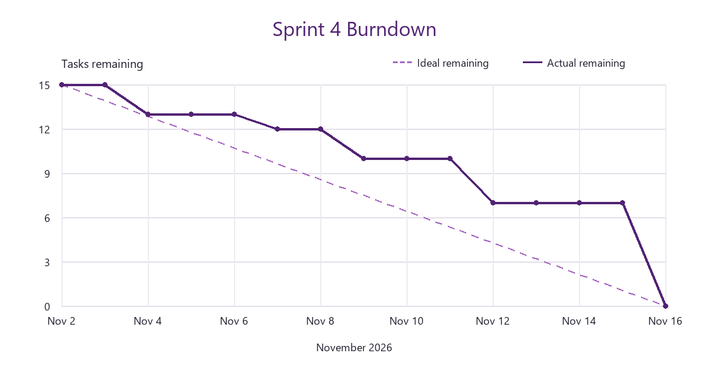

# Sprint 4 Reflection

## Sprint outcome

We added Command Hub, key-based room progression, and a Tab screen for previewing rooms and choosing a fireball. The HUD shows the equipped shot and live health and inventory values. We also added Ice attacks, more weapon options, and selfie mode and its gallery. Room progress now tracks collected pickups and opened crates during a run.

## Code quality and testing

We moved item-use rules into PlayerInventory and grouped the HUD inventory values behind one read-only property. We separated spawn search and crate setup from Level. We also moved slider and elevator rules and block contacts out of BlockCollision. Clearer names such as TryGroundedJump make it easier to see what each method does.

The Strict code build and 54 crumbling-platform checks passed after the collision changes. Those checks cover part of the collision work. Getting hit on a rising elevator and riding a slider into a wall still need direct playtesting.

## Team process and burndown

Team members worked on different features in parallel. When collision changes touched the same files, we compared the edits before combining them. We kept the team’s knockback tuning and transformation check alongside the platform changes.

The dashed line shows an ideal pace from 15 tasks remaining to zero. The solid line shows actual work remaining, calculated by subtracting completed tasks from the 15 tracked tasks. Seven tasks remained on November 12, and the board showed zero remaining on November 16.

## Next sprint

For Sprint 5, we plan to update shooting and attack progression, redesign levels, improve door and key logic, and add ammo and inventory changes. We also plan to refresh enemy sprites and behavior, redesign the HUD and menus, and improve the Wild West audio. See the [Sprint 5 plan](Sprint5-FeatureIdeas.md).

- Merge shared changes earlier and run the affected checks after each merge.
- Test platform collisions in gameplay, especially where elevators or sliders meet walls and ceilings.
- Keep the task board current so it reflects progress as work is completed.
