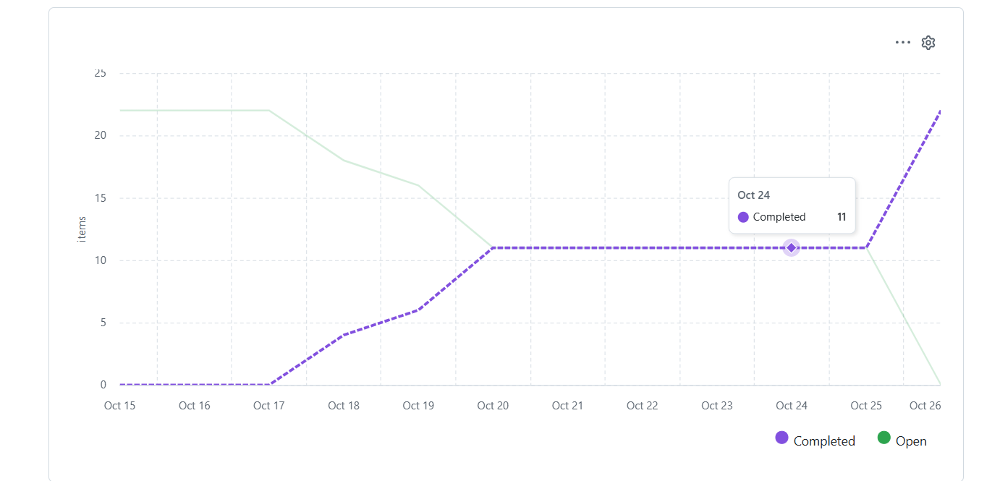

# Sprint 3 Reflection

## Sprint outcome

This sprint, we added connected rooms, room switching, collision handling, a boss, more items, and interactive platforms. We also added room checks and worked on code warnings and reviews. Splitting the work between team members helped us build different parts of the game at the same time. The combined game still needs more playtesting.

## Burndown discussion

The chart covers October 15–26. The green line shows unfinished tasks, and the purple line shows completed tasks. We started with 22 open tasks and ended with all 22 marked complete. Progress was recorded around October 18–20, followed by a flat period and a large final change on October 26.

Some tasks were already finished, but team members forgot to mark them complete on the board until October 26. The final drop does not mean all the work happened that day. Flat sections also do not mean nobody was working. This chart shows task updates, not Git commits, and it does not have an ideal-progress line.

## Team process

Separate branches helped us work without constantly changing each other's files. Room checks helped us catch mistakes such as extra enemies or unreachable exits. Code reviews helped us discuss what was clear and what needed improvement.

However, late board updates made it hard to see our real progress. Changes to shared files also needed careful merging and testing. Marking every task complete on the board does not prove that every part of the game is bug-free.

## Next sprint

- Update the board when a task is finished, rather than waiting until the end.
- Keep tasks small, with one clear owner and a clear way to check completion.
- Merge working changes earlier and run the checks after merging.
- Finish reviews earlier and leave time for a full team playtest.
